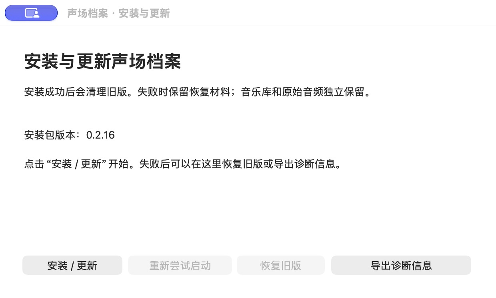

# 安装与更新生命周期（未发版）

## 2026-11-05：更新窗口重新排版与诊断文件定位

更新窗口改为版本信息、更新状态、诊断结果和底部主操作四个层次。安装路径、原始错误、诊断保存路径默认折叠；错误状态优先展示简短说明和诊断操作，更新说明在独立区域滚动。保留浅色/深色主题，小窗口下内容滚动、底部主操作固定可见。

诊断 ZIP 保存成功后通过现有 `opener.revealItemInDir` 自动在 Finder 中选中该文件，窗口显示文件名及“在 Finder 中显示诊断文件”按钮。再次定位不重新导出；Finder 打开失败时保留已成功保存的文件与原更新错误，允许重试定位。取消重新导出保留上次文件及定位入口。原始错误仍进入诊断上下文，并可展开“错误详情”查看。无需新增 IPC 命令或扩大权限。

先增加回归复现缺少自动定位/重试行为，再实现新交互。新增覆盖：导出与定位顺序、再次定位不重新导出、Finder 失败后重试、取消/导出失败不打开 Finder、取消第二次导出保留第一份文件、简短提示与原始错误分离。原有仅检查“已导出 + 路径”文案的断言随新需求改为检查成功标题、文件名及实际定位调用，导出次数和原错误保留的断言继续保留。

实际验证：

| 命令 / 验收 | 结果 |
|---|---|
| `node --check frontend/app.js`、`node --check frontend/updater.js` | 通过 |
| `node --test scripts/test-*.cjs` | 269 通过，0 失败 |
| `python3 scripts/test-update-manifest.py`、`test-release-plan.py`、`test-publish-release.py`、`test-update-artifacts.py`、`test-local-update.py` | 分别 4、12、8、4、12 通过，合计 40 |
| `(cd src-tauri && cargo test --locked --offline --lib)` | 76 通过，0 失败 |
| `bash scripts/test-macos-installer.sh` | 91 通过，0 失败 |
| `node frontend/.preview/build-preview.cjs frontend/index.html frontend/preview.html` + 本机 HTTP 服务 + `shot.mjs` | 浅色导出结果、暗色 900×600 最小窗口、长更新说明均通过；截图已读取，页面异常/console error 为 0 |
| 隔离原生 App 构建与窗口操作 | 实际点击导出并通过系统对话框保存；Finder 自动选中 ZIP。关闭该 Finder 窗口后点击新按钮，再次打开并选中同一 ZIP |
| `CARGO_NET_OFFLINE=true cargo tauri build --bundles app --target aarch64-apple-darwin` | 通过 |
| `bash scripts/build-macos-installer.sh <App> /private/tmp/music-manager-update-ui-production-20261105/music-manager_0.2.8_aarch64.dmg` | 签名、DMG 完整性及兼容元数据通过 |

完整回归合计 476 项通过。原生验证根目录 `/private/tmp/music-manager-desktop-local-layout-20261105`，证据为 `evidence/finder-layout-result.json` 与 `exports/新版更新诊断.zip`；再次定位前后 ZIP 的修改时间和 SHA-256 均不变。已确认原始错误、启动尝试日志保留，未包含音乐库、设置、音频或 DMG；原生 App 的 `updater.js` 和 `style.css` 与当前工作区一致。

预览图和页面日志位于 `/private/tmp/music-manager-update-layout-20261105`，包含 `cream-export-final.png`、`night-minimum-final.png`、`ready-notes.png`。Finder 无法打开的分支通过注入失败的回归测试覆盖，未修改系统权限来制造原生拒绝。Intel、跨账户和真实系统目录提权仍未实测；版本号未修改，未提交或发布。

## 2026-11-05：提交前 review 与最终验证

本轮检查旧位置记录迁移、协议 1 失败响应、原生诊断导出、开发入口和本地测试目录的隔离/重置/清理。发现主应用诊断包遗漏安装器实际写在 `<事务>/attempts/<启动令牌>/` 下的启动日志；先加入真实目录结构的回归，修复前测试失败（ZIP 只有 summary），再补充最近五个会话各最多五次启动尝试的已知文件收集。文件名白名单、UUID 目录校验、符号链接拒绝和单文件 2 MB 限制保留。

新增回归覆盖 `application.log`、`startup.json`、`attempt.json`、`error.txt`，确认跳过数据库、未知目录和符号链接。修复后通过真实隔离 App 的“软件更新 → 导出诊断信息”及系统保存对话框导出，实际 ZIP 中的三份启动尝试文件与此前真实隔离升级留下的文件逐字节一致，原更新错误仍显示。隔离根目录：`/private/tmp/music-manager-desktop-local-review-20261105`；证据：`exports/review-startup-attempts.zip` 和 `evidence/review-export.json`。测试应用的诊断模块源码摘要与最终工作区一致。

最终实际执行：

| 命令 / 验收 | 结果 |
|---|---|
| `node --check frontend/app.js`、`node --check frontend/updater.js` | 通过 |
| `node --test scripts/test-*.cjs` | 264 通过，0 失败 |
| `python3 scripts/test-update-manifest.py` | 4 通过 |
| `python3 scripts/test-release-plan.py` | 12 通过 |
| `python3 scripts/test-publish-release.py` | 8 通过 |
| `python3 scripts/test-update-artifacts.py` | 4 通过 |
| `python3 scripts/test-local-update.py` | 12 通过 |
| `(cd src-tauri && cargo test --locked --offline --lib)` | 76 通过，0 失败 |
| `bash scripts/test-macos-installer.sh` | 91 通过，0 失败 |
| `(cd src-tauri && cargo build --locked --offline)` | 通过 |
| `CARGO_NET_OFFLINE=true cargo tauri build --bundles app --target aarch64-apple-darwin` | 通过 |
| `bash scripts/build-macos-installer.sh <App> /private/tmp/music-manager-review-production-20261105/music-manager_0.2.8_aarch64.dmg` | 签名、DMG 完整性和兼容元数据通过 |
| `actionlint .github/workflows/ci.yml`、`git diff --check` | 通过 |

本轮修复后的完整回归共 471 项通过。目前未发现阻止提交的问题。0.2.6/0.2.7 升级、原生保存/取消/Finder 及本地开发入口的既有验收见下方记录；本轮仅补诊断收集路径，没有改安装替换流程。真实系统目录管理员授权、跨账户及 Intel 实机仍未验证；PR CI/`CI Ready` 尚未触发。没有修改正式数据、版本号或发布资产。

## 2026-11-04：可重复使用的本地更新测试入口

新增 macOS 开发构建参数，用户在平时运行开发模式的 `src-tauri` 目录执行：

```bash
cargo tauri dev --no-watch -- -- --local-update-test
```

参数在 Tauri Builder、正式配置和音乐库初始化之前分流到 `scripts/local-update-test.py`。启动器使用独立 identifier、自动分配的回环端口、临时签名密钥、生成的测试 WAV/SQLite，以及隔离的旧 App 与更高版本更新 DMG。剥离外层 `cargo tauri dev` 注入的 `TAURI_CONFIG`、`TAURI_ENV_*` 和签名环境变量，避免覆盖隔离配置或使用正式私钥。默认测试当前源码版本到下一个补丁版本；可指定 `--from-version 0.2.6` / `0.2.7`。正式版本号保持 0.2.8。

终端支持 `success`、`install-failure`、`bad-signature` 场景，`repair` 修复模拟故障，`open` 重新打开当前 App，`status` 查看事务，`quit` 清理测试 App/包并保留数据与日志。场景切换复用已构建的包，保留测试库；正在运行的安装器、未知身份 App、符号链接和缺失基础包会阻止破坏性重置。正常开发命令不变，正式 release 构建拒绝测试参数并在初始化前退出。

本轮通过用户将实际使用的完整命令启动，根目录 `/private/tmp/music-manager-desktop-local-e2e-20261104`，动态更新源为 `http://127.0.0.1:65490`。真实原生窗口操作完成：

- `install-failure`：检查、下载、签名校验、确认更新后出现安装记录错误；终端 `repair` 后从同一窗口重试，完成 0.2.8 → 临时 0.2.9 的真实替换和启动。事务 `completed` / `ready` / `cleanupPending=false`，样例曲目、片段、设置与 WAV 摘要一致。
- `bad-signature`：从终端重置到旧 App，无重新编译；原生窗口下载后明确报签名失败，不能重启安装。终端 `repair` 恢复原签名字节，再下载通过，界面恢复“重启并更新”。
- `success`：从终端恢复正常测试场景，旧 App 重新打开，样例数据保留。
- `quit`：启动命令正常退出，测试 App/更新包清理，测试库与证据保留。

实际检查：

| 命令 / 项目 | 结果 |
|---|---|
| `node --check frontend/app.js`、`node --check frontend/updater.js` | 通过 |
| `node --test scripts/test-*.cjs` | 264 通过，0 失败 |
| `python3 scripts/test-update-manifest.py` | 4 通过 |
| `python3 scripts/test-release-plan.py` | 12 通过 |
| `python3 scripts/test-publish-release.py` | 8 通过 |
| `python3 scripts/test-update-artifacts.py` | 4 通过 |
| `python3 scripts/test-local-update.py` | 12 通过；已接入 CI |
| `(cd src-tauri && cargo test --locked --offline --lib)` | 75 通过，0 失败 |
| `bash scripts/test-macos-installer.sh` | 91 通过，0 失败 |
| `(cd src-tauri && cargo build --locked --offline)` | 通过 |
| `CARGO_NET_OFFLINE=true cargo tauri build --bundles app --target aarch64-apple-darwin` | 通过 |
| 生产配置 App 执行 `--local-update-test --help` | 按设计返回退出码 2，无应用初始化 |
| `bash scripts/build-macos-installer.sh <App> /private/tmp/music-manager-local-update-production-20261104/music-manager_0.2.8_aarch64.dmg` | DMG、签名与兼容元数据通过 |
| `actionlint .github/workflows/ci.yml`、`git diff --check` | 通过 |

入口帮助实测为 `cargo tauri dev --no-watch -- -- --local-update-test --help`；Tauri 实际转发为 `cargo run ... -- --local-update-test --help`。本轮没有改前端交互代码，因此沿用前轮已完成的浏览器预览和原生导出检查，并新增上述启动器真实窗口验收。证据位于本次根目录 `evidence/before.json`、`upgrade-success.json`、`signature-scenario.json`、`local-cli-result.json`；原生截图已在聊天中读取。

限制：本轮新入口的完整窗口验收使用当前源码 0.2.8 → 临时 0.2.9；历史 0.2.6/0.2.7 的真实升级见下方已有记录，新入口的历史版本参数通过规划/参数校验，未在本轮再次完整跑旧版 GUI。Intel 实机、跨账户与真实系统目录提权未验证。测试 App 以本机独立目录为安装目标，不替代正式 `/Applications` 提权验收。未提交、未发布，PR CI 尚未触发。

## 2026-11-04：补齐最终代码的原生窗口验收

本次补齐下方记录中“原生鼠标操作、保存对话框和 Finder 未视觉验收”的缺口。使用可用的原生桌面控制直接点击 App 和系统对话框；没有注入自动更新操作或模拟保存对话框。产品代码未修改，原有完整回归及生产配置 App/DMG 构建结果仍适用于当前代码。

隔离根目录为 `/private/tmp/music-manager-desktop-native-final-20261104`，identifier 为 `com.musicmanager.acceptance.c7aaa825f284`。由 `v0.2.6` 标签构建原客户端，由当前代码构建 0.2.8 和临时测试版本 0.2.9；0.2.9 只用于触发新版更新失败，没有修改项目版本或发布。应用、安装目标、记录、下载源和音乐库均独立。

已从真实窗口完成：

1. 原版 0.2.6 点击“更新”、下载、点击“重启并更新”并在原生确认框确认。故意损坏的隔离记录触发失败；Finder 自动显示并选中“声场档案更新诊断.zip”，旧应用仍运行，报错中准确显示同一 ZIP 路径。已读取旧应用截图并检查 ZIP 内的原错误，不含数据库、设置或音频。
2. 恢复有效的隔离旧记录，再次从原版窗口确认更新。0.2.8 正常打开并显示原测试曲目，事务 `completed` / `ready` / `cleanupPending=false`；旧 App 清理，旧记录按原字节归档，数据比对一致。
3. 新版窗口检查并下载临时 0.2.9 包，确认更新，故意损坏的新状态触发真实安装交接失败。失败后“导出诊断信息”按钮可用。
4. 实际点击导出，系统保存对话框正常出现。点击 Cancel 后回到原错误，未生成输出文件。再点击导出，通过系统“前往文件夹”选择本次 `exports` 目录并保存 `native-diagnostics-success.zip`；主窗口同时显示导出成功路径和原更新错误，按钮恢复可用。
5. 检查实际 ZIP 的 CRC、上下文（当前 0.2.8、目标 0.2.9、原错误）、损坏安装记录和日志；不含 `library.db`、`settings.json`、音频或 DMG。取消、失败、升级及导出后的测试库业务行、位置配置、音频 SHA-256 与基线一致，仍仅排除正常启动可变化的书签、音乐更新时间和应用版本元数据。

安装器启动新版时 macOS 将临时路径显示为 `/tmp`，Tauri updater 因该系统别名拒绝初始化。已退出测试应用并从规范 `/private/tmp` 路径重新打开后继续验收；没有放宽生产路径或签名校验。取消保存的检查以真实对话框、原错误保留和输出文件不存在为证据；本次没有记录导出 IPC 次数，不以缺少事件日志推断次数。

额外实际执行 `python3 scripts/test-installer-ui.py`，四项原生安装器窗口检查通过。此前与当前产品代码对应的结果已再次核对：Node 264、Rust 73、安装器 91、Python 28 项均通过；两个 Node 语法检查、Rust build、Apple Silicon App/DMG 构建及校验通过。当前 `git diff --check` 通过。源码摘要检查确认本次原生验收的 `app.js`、`updater.js`、`style.css`、`update_diagnostics.rs` 与工作区一致。

证据在本次隔离根目录的 `evidence/native-ui-result.json`、`legacy-native-failure.json`、`cancel-save.json`、`before.json`、`after-legacy-failure.json`、`after-native-upgrade.json`、`after-native-export.json`，以及 `exports/native-diagnostics-success.zip`。原生窗口截图已在本次聊天中读取；窗口动作与最终可见结果由原生桌面工具返回。

本地要求的原生窗口验证已补齐。真实系统目录提权、跨账户、Intel 实机及实体移动硬盘仍列为未验证环境；本次没有操作正式安装或真实音乐库。提交需用户明确授权，PR 双架构 CI 和 `CI Ready` 尚未触发，不能声明通过；版本保持 0.2.8，未发布。

## 2026-11-04：补充诊断入口与原版 0.2.6 升级验收

应用内更新面板新增“导出诊断信息”及单独的导出结果提示。选择 ZIP 保存位置后调用 `export_update_diagnostics`，保留原更新错误；取消保存不写文件，导出期间禁止重复操作。后端独立收集最近五次安装/交接的已知日志文件、安装状态与当前错误上下文；单文件最多 2 MB，跳过符号链接和不可读文件并记录遗漏，不打包音乐库、设置、音频或更新 DMG。记录损坏或安装器未启动也能导出。

原版 0.2.6/0.2.7 的更新客户端收到失败响应后会终止安装器，因而安装器窗口原有的导出按钮随之消失。这些已发布客户端不能新增按钮；新版安装器对协议 1 的失败先生成 ZIP、调用 Finder 显示，再把包含文件位置的错误返回旧客户端。初始化失败也能生成最小错误报告；导出自身失败时保留原错误并说明原因。协议 2 使用主应用的导出入口，不自动导出。

新增回归先确认失败，再实现导出：前端缺少导出方法的三项失败、Rust 三项导出行为失败、Swift 新的失败响应接口尚不存在。完成后实际结果：

| 命令 / 验收 | 结果 |
|---|---|
| `node --check frontend/app.js`、`node --check frontend/updater.js` | 通过 |
| `node --test scripts/test-*.cjs` | 264 通过，0 失败 |
| `python3 scripts/test-update-manifest.py` | 4 通过，0 失败 |
| `python3 scripts/test-release-plan.py` | 12 通过，0 失败 |
| `python3 scripts/test-publish-release.py` | 8 通过，0 失败 |
| `python3 scripts/test-update-artifacts.py` | 4 通过，0 失败 |
| `(cd src-tauri && cargo test --locked --offline --lib)` | 73 通过，0 失败 |
| `bash scripts/test-macos-installer.sh` | 91 通过，0 失败；含 0.2.6/0.2.7 原格式记录及失败导出顺序 |
| `(cd src-tauri && cargo build --locked --offline)` | 通过 |
| 隔离源副本中 `cargo tauri dev --no-watch`，独立 identifier、测试库及启动报告 | 构建并运行，报告 `ready`，结束后退出 |
| `(cd src-tauri && CARGO_NET_OFFLINE=true cargo tauri build --bundles app --target aarch64-apple-darwin)` | 通过 |
| `bash scripts/build-macos-installer.sh <App> <隔离根目录>/production-final/music-manager_0.2.8_aarch64.dmg` | App/安装器签名、DMG 完整性、兼容元数据校验通过 |
| `node frontend/.preview/build-preview.cjs frontend/index.html frontend/preview.html`，本机 HTTP 服务及 `shot.mjs` | 1440×900 和 900×800 下模拟交接失败、点击导出、保留原错误；页面异常及 console error 为 0，截图已读取 |

隔离根目录：`/private/tmp/music-manager-desktop-diagnostics-20261104`。`build-fixture.py` 从 `v0.2.6` 标签构建原客户端，从当前代码构建候选 0.2.8，使用独立 identifier、本机临时签名更新源、测试 SQLite 和生成的 WAV。额外前端测试驱动调用真实更新 IPC，没有替换下载、验签、旧客户端交接或安装器实现；不把它描述为人工点击原生确认框。

实际通过两条路径：

- 故意放入损坏的安装记录：旧客户端收到失败，继续运行；安装器被旧客户端结束前 ZIP 已生成，错误中包含准确 ZIP 位置；ZIP 内有原错误，未包含数据库/设置/音频，测试数据一致。
- 改回有效的 0.2.6 已完成旧记录并重试：真实签名包完成交接、迁移和启动，最终 `completed` / `ready` / `cleanupPending=false`；旧 App 已清理，旧记录按原字节归档。逐表业务数据、位置配置和 WAV 摘要一致，排除正常启动可变化的书签、音乐更新时间及应用版本元数据。新版真实 `export_update_diagnostics` IPC 生成 ZIP 并检查内容通过。

验收准备中先发现测试曲目使用“专辑名跟随文件夹”，启动时专辑名会正常变化；改为手动专辑来源后保持原有数据断言。随后修正测试驱动未及时回收已退出子进程、导致安装器仍观察到 PID 的问题。两次未完成尝试均保留独立日志，未放宽产品判断或数据断言。

证据：隔离根目录下 `evidence/result.json`、`legacy-failure.json`、`before.json`、`after-failure.json`、`after.json`、`native-diagnostics.zip`、`native-acceptance.log`，以及 `diagnostics-preview-final.png`。本轮原生鼠标操作、保存对话框和 Finder 窗口没有人工视觉验收；已验证真实应用及文件结果。真实系统目录提权、跨账户与 Intel 实机仍未实测。正式配置、音乐库与音频未读写；修复未提交、未发版。

验收后已停止测试 App、安装器、开发模式进程与两个本地 HTTP 服务，按归属清单清理测试 App、下载包和源副本；保留上述证据与 `production-final/music-manager_0.2.8_aarch64.dmg` 本地候选。

## 2026-11-04：修复 0.2.7 个人安装记录阻断升级

本机安装器日志确认：旧 `latest.json` 是个人“应用程序”目录内已完成的 0.2.7 安装事务；0.2.8 改用系统目标时，初始化调用 `archiveReceipt()`，误将个人路径记录交给系统状态写入接口，触发“系统事务记录无效”，界面显示“更新记录无法安全读取”。失败发生在应用替换前。

修复只在加载旧 Logs 记录、且该记录已结束并指向另一位置时生效：验证原路径，在用户 Logs 的 `transactions` 下持久化原始 JSON，成功后移除旧活动记录，再开始新目标事务。系统专用状态中的异地记录仍拒绝；归档失败保留活动记录；未完成事务仍阻止迁移。没有改数据库 schema、版本号或发布资产。

先加入旧版字段结构的回归，修复前实际失败：`personal receipt was incorrectly archived into system state`。修复后新增五项覆盖三种结束状态、专用状态隔离、归档失败保留证据，包含真实临时文件迁移与启动子进程。

本轮实际执行（均为本地验证，未提交或发布）：

| 命令 / 验收 | 结果 |
|---|---|
| `node --check frontend/app.js`、`node --check frontend/updater.js` | 通过 |
| `node --test scripts/test-*.cjs` | 260 通过，0 失败 |
| `python3 scripts/test-update-manifest.py` | 4 通过，0 失败 |
| `python3 scripts/test-release-plan.py` | 12 通过，0 失败 |
| `python3 scripts/test-publish-release.py` | 8 通过，0 失败 |
| `python3 scripts/test-update-artifacts.py` | 4 通过，0 失败 |
| `(cd src-tauri && cargo test --locked --offline --lib)` | 70 通过，0 失败 |
| `bash scripts/test-macos-installer.sh` | 84 通过，0 失败 |
| `(cd src-tauri && CARGO_NET_OFFLINE=true cargo tauri build --bundles app --target aarch64-apple-darwin)` | App 构建、ad-hoc 签名通过 |
| `bash scripts/build-macos-installer.sh <arm64 App> <隔离根目录>/production-package/music-manager_0.2.8_aarch64.dmg` | DMG、嵌套签名、hdiutil 校验及兼容元数据通过 |
| 独立源副本中 `cargo tauri dev --no-watch`，指定隔离配置、共享编译目录和启动报告 | 构建并启动，报告 `ready`；结束后退出进程 |
| `git diff --check` | 通过 |

打包首次受执行沙箱限制报“设备未配置”，授权扩大构建执行范围后通过。另一次候选 DMG 使用非标准文件名，包身份校验拒绝；改用标准版本/架构命名重新完整构建通过，未放宽校验。开发模式最初在受限环境未生成启动报告，扩大执行范围后实际启动成功。

原生验收根目录：`/private/tmp/music-manager-desktop-receipt-20261104-fix`；独立 identifier：`com.musicmanager.acceptance.5c2b05ad5f52`。使用 `build-fixture.py` 从 `v0.2.7` 标签及当前代码构建旧、新客户端，预置原格式已完成旧记录。验收安装器仅把目标重定向到隔离的 `SystemApplications`，旧客户端使用隔离的 `Applications`，日志、缓存和 SQLite 都独立。测试签名及下载服务仅用于本机验收。

通过真实 0.2.7 窗口完成检查、下载、签名校验、确认更新；0.2.8 窗口实际显示原测试曲目，截图已读取。新事务为 `completed` / `ready` / `cleanupPending=false`，旧位置 App 已清理，旧记录归档与原字节一致。测试库逐表业务记录、设置和 WAV SHA-256 一致；正常启动可变化的 `music.file_bookmark`、`music.updated_at` 和 `app_metadata.app_version` 排除在逐表比对之外。

证据保存在隔离根目录的 `evidence/upgrade-result.json`、`before.json`、`after.json`、`legacy-receipt-before.json`、`dev-startup.json` 和安装日志。测试进程、HTTP 服务已退出，测试 App、下载包及源副本按归属清单清理；保留本地生产配置修复 DMG，不自动安装或发布。

限制：未执行真实 `/Applications` 管理员授权和跨账户安装，未验证 Intel 实机、不同 macOS 或实体移动盘。本次没有更改正式应用、正式安装记录、音乐库或音频；本地修复不会自动改变用户已下载的发布包。

基线：main `cb2a063`。应用版本仍为 0.2.7，数据库 schema 仍为 3。本次不操作正式配置、音乐库、音频或开发者历史安装。

## 用户行为

最终产品规则：统一安装到系统“应用程序”，安装器不显示路径、不提供位置选择和历史清理入口。底部保留原版四个按钮。旧位置的正式副本根据当前客户端、运行进程、用户应用程序目录及迁移记录识别，验证后迁移，启动确认后清理；未知、开发目录和 DMG 副本不删除。

下载校验独立签名和已签名兼容元数据，记录版本、架构、包摘要、协议、最低系统和客户端。验证后的下载可跨进程复用。安装先暂存和校验，再通过「确认 / 取消」协调退出。确认后忽略未保存的输入，不自动保存或校验音乐、片段及标签草稿；已经提交的写入仍须完成。手动安装与应用内更新进入同一 Swift 事务。旧客户端不支持退出协议时要求自行保存并退出。

启动以令牌、版本、PID 和实际应用路径确认。ready、待选库、缺盘保护均为有效安装结果，须维持至少两秒；主动退出选库单独记录。失败或超时不提交。提交后旧版删除，不再提供恢复旧版；之后以同版修复安装或更高版本处理。音乐库不随应用恢复或清理。

## 状态、权限与文件

- Rust 下载协调状态位于应用缓存的 `updates`，每次使用前重新验签和核对摘要。
- 用户安装事务位于 `~/Library/Application Support/com.musicmanager.installer/user`；系统事务在 `/Library/Application Support/com.musicmanager.installer/system`，与 Logs 分离。
- 目标锁覆盖不同日志目录；系统锁由 root 创建、所有账户可读取并加锁。正常启动遵守目标锁，安装器明确启动的子进程可回报启动状态。
- 管理员操作通过一次授权的短期 Swift 执行器处理，只允许固定安装路径与限定文件动作；不接受任意 shell，不以 root 启动应用、不打开音乐库。
- 暂存与恢复应用在目标卷内；新命令、记录读写、删除均拒绝受管路径中的符号链接。macOS `/var`、`/tmp` 系统别名例外。
- 用户主动选择退出前，后端门禁拒绝新写入并等待已接受操作完成；取消或失败解除门禁。

阶段：检查 → 下载 → 已验证 → 已暂存 → 等待退出 → 替换 → 已就位 → 启动确认 → 已提交 → 清理完成。清理失败保持已提交，不降级。移动边界与状态落盘中断由原事务对账处理。

提交后清理旧版、失败新版暂存、下载包与内嵌应用；正在执行的安装器稍后清理。未引用且未交接的有效下载超过24小时可清理。有明确运行归属标记的日志默认30天/100 MiB；未标记的历史或未知目录不自动删除。已完成事务摘要保留20条；活动和待清理事务不按期限丢弃。未知文件不自动清理。

历史事务保持原始记录，验证身份和路径后使用。历史残留内部方法保留，但普通界面入口已移除。不能确认的文件保留。事务损坏停止替换、恢复并允许导出诊断，不靠删除记录解除保护。

## 接口与兼容

保留 `check_app_update`、`download_app_update`、`restart_for_app_update`。增加安装状态、持久化更新状态、取消、退出准备/撤销、重试清理和 Finder 定位。进度带事务ID；界面重新打开时查询后端。更新错误包含稳定类别与可读信息。

安装器接受协议1旧参数和协议2新参数，旧包名称与内嵌路径保持。新客户端下载前要求签名兼容元数据；独立元数据绑定DMG摘要，旧清单字段保持以兼容旧客户端。

主应用提供 `--installer-update-info` 只读检查入口，不创建窗口或打开数据库。打包验证构建内的版本、公钥指纹、更新端点和协议，防止发布不能继续更新的版本。

当前公钥不轮换。`updater-trusted-public-key.txt` 表示本次发布的签名信任根，通常与应用公钥相同。轮换时先保持旧信任根与旧签名Secret，应用内置新公钥；兼容元数据携带 `nextPublicKey`，由旧钥签名授权并绑定新指纹。过渡版发布后，下一次发布同步切换信任根和Secret到新钥。轮换须单独验收，禁止同时失去旧钥；私钥丢失时通过手动安装恢复更新链，不放宽签名校验。免费签名不等于 Developer ID 或公证，首次系统放行限制仍存在。

## 发布与测试入口

沿用单一CI与main新版本自动发布。构建产物增加 `.dmg.metadata.json`，发布任务签名DMG与元数据，验证后生成清单。先创建带提交来源标记的草稿、上传资产、核对远端大小/摘要，再公开；仅允许重试同提交草稿，不覆盖已发布版本。

```bash
node --check frontend/app.js
node --check frontend/updater.js
node --test scripts/test-*.cjs
python3 scripts/test-update-manifest.py
python3 scripts/test-release-plan.py
python3 scripts/test-publish-release.py
python3 scripts/test-update-artifacts.py
bash scripts/test-macos-installer.sh
(cd src-tauri && cargo test --locked --lib)
(cd src-tauri && cargo build --locked)
(cd src-tauri && cargo tauri build --bundles app --target aarch64-apple-darwin)
```

验收脚本支持从 `v0.2.6`、`v0.2.7` 构建隔离旧客户端。生成的验收App从共享bundle输出中移出，只允许清理有验收清单的独立目录；不删除整个target。

验收记录与未覆盖项目在交付时单列。模拟权限、跨进程锁和故障注入不能代表真实跨账户授权、Intel实机、不同macOS或断电验证。

旧版 0.2.6/0.2.7 固定校验 `AI-AQI/music-manager` URL，因此过渡清单继续使用该地址，由 GitHub 重定向到 `qivyn/music-manager`；新客户端仅允许这两个明确地址，包签名仍为最终信任依据。发布前必须核对旧地址仍映射到当前仓库；失效时停止发布并通过手动安装迁移，不扩大到任意地址。

## 本轮实际验证（2026-11-03）

实现分支 `codex/installer-lifecycle`，基线 `cb2a063`；未提交、未推送、未发布，正式版本号仍为 0.2.7。下列 0.2.10～0.2.15 仅为 `/private/tmp` 隔离验收的临时版本号，不是已发布版本。

| 实际执行 | 结果 |
|---|---|
| `node --check frontend/app.js`、`node --check frontend/updater.js` | 成功 |
| `node --test scripts/test-*.cjs` | 212 通过、0 失败 |
| `python3 scripts/test-update-manifest.py` | 3 通过 |
| `python3 scripts/test-release-plan.py` | 12 通过 |
| `python3 scripts/test-publish-release.py` | 3 通过 |
| `python3 scripts/test-update-artifacts.py` | 4 通过 |
| `bash scripts/test-macos-installer.sh` | 73 通过；包含真实临时文件移动与子进程，权限和签名失败由 FakeIO 注入 |
| `(cd src-tauri && cargo test --locked --offline --lib)` | 70 通过、0 失败 |
| `(cd src-tauri && cargo build --locked --offline)` | 成功 |
| `CARGO_NET_OFFLINE=true cargo tauri build --bundles app --target aarch64-apple-darwin` | 成功，完整 ad-hoc 签名 App |
| `bash scripts/build-macos-installer.sh <App> <临时候选.dmg>` | 已成功生成候选 DMG、验证嵌套签名与 hdiutil 校验和、生成绑定摘要的兼容元数据 |
| 预览生成、`shot.mjs` 更新面板截图、读取图片 | 完成，未输出页面异常或 console error |
| 隔离 `cargo tauri dev --no-watch --config <独立标识>` | 启动并回报 `ready`；当时 Mac 已锁屏，未把开发窗口视觉检查计为通过 |
| `git diff --check`、Python 语法与打包 shell 语法 | 通过 |

已检查基线 main 的 GitHub Actions：前端、后端/安装器和发布判断成功；构建、发布按条件跳过。当前新增实现尚未提交，因此没有当前分支 CI 通过的声明。

真实桌面验证使用独立 identifier、临时 SQLite、生成的 WAV 和临时更新签名：

- 已下载更新退出后重新打开，恢复“已下载待安装”，没有重复下载。
- 从 `v0.2.6` 标签构建的隔离原客户端完成协议1交接、替换并回报 ready；其提交标记生成成功，后续统一维护也清除了旧客户端缓存。
- 补验完成：从 `v0.2.7` 标签构建的隔离原客户端，通过真实窗口执行检查、下载、签名校验、确认重启，升级至当前代码的临时 0.2.15。新版窗口正常展示测试音乐，事务 `completed`、启动结果 `ready`、`cleanupPending=false`；测试库逐表快照一致（排除应用版本元数据与系统书签字段），音频 SHA-256 一致，旧版 App 与下载缓存均为零。证据：`/private/tmp/music-manager-desktop-lifecycle-20261103/evidence/original-0.2.7-final-update.json`。
- 隔离新客户端完成协议2交接，提交后旧版 App 为零、更新缓存目录为空。
- 手动安装请求运行中应用确认；取消后原应用继续运行，重试确认后更新完成，恢复旧版按钮禁用。
- 更高版本接续失败的启动确认事务，保留音乐库与音频，成功后清理本事务及已被修复事务取代的旧版。
- 所有已完成实际升级前后，测试音乐记录保留，WAV SHA-256 不变。
- 连续五次提交后不残留旧 App，由 Swift 集成测试覆盖；不等同于五次生产安装器的人工实测。

实际验收发现并修复了本项目对 `/tmp` 与 `/private/tmp` 的路径比较问题。Tauri 自身仍拒绝某些经 `/tmp` 别名启动的进程初始化 updater；未开启其危险 symlink 选项。后续检查更新测试从规范路径重新启动隔离客户端。验收脚本的事务目录替换也已增加断言，避免隔离环境误读其他状态目录。

另核对了 v0.2.6/v0.2.7 公钥与当前一致；旧命名空间的实际 v0.2.7 安装包 URL 跟随重定向返回 HTTP 200。

### 尚未完成与保留材料

- 真实系统目录管理员授权、跨账户并发、Intel 实机、不同 macOS、断电与实体移动盘插拔未实测；相应自动化模拟不能替代这些验证。
- 草稿上传、远端摘要验证、公开发布和密钥轮换未对正式 GitHub Release 执行；发布器和密钥授权路径由隔离测试覆盖。
- 本机可执行的原版 0.2.7 升级补验已完成；上述硬件、授权及发布环境项目仍单独保留为未实测，不能宣称全环境实测通过。

本轮隔离应用、安装器、源码副本与下载包已按归属清单清理，核对隔离根目录内 `.app` 数量为零；此前为锁屏保留的恢复压缩包也已删除。保留日志、证据 JSON、测试库及不可直接启动的生产配置构建证据。测试 HTTP 服务与隔离应用均已停止，没有清理开发者此前的历史应用或正式安装。

收尾发现验收清理脚本同时登记父目录与子文件时会重复删除并报错；已先增加失败测试，再改为按路径深度从子项开始清理，4 项产物测试通过，并实际完成清理。该修复仅影响隔离验收脚本。

### 安装器界面收敛（历史记录，已由默认安装规则取代）

主窗口恢复原版四个按钮，新增三个入口移至顶部「工具」菜单。`python3 scripts/test-installer-ui.py` 在修改前因七个按钮失败，修改后四项窗口检查通过；隔离原生窗口实际确认主窗口与菜单，截图 `/private/tmp/music-manager-installer-four-buttons.png`，未执行安装，预览 App 已清理。重新执行前端语法检查、Node 212 项、更新清单 3 项、发布判断 12 项、Rust 70 项、Swift 安装器 73 项，全部通过；`git diff --check` 通过。仅修改原生安装器布局及菜单，没有改应用替换、签名或更新协议，因此本次未重复应用升级或 Tauri 打包。


### 最终默认安装与旧位置迁移（2026-11-03）

此规则取代早期“唯一安装原位置更新”和“可选当前用户安装”。正常安装界面不显示路径，不出现位置选择、Finder 或历史清理入口；底部保留原版四个按钮。首次及后续安装均以系统 Applications 为目标。已验证的旧来源保留到新版启动确认后，再核对身份/签名/摘要及目录 inode/device 后删除；清理失败记录待清理，不能撤销已提交安装。受保护的任意旧路径不会交给 root 清理。

旧来源按当前交接客户端、运行中的正式应用、用户 Applications 及持久化迁移记录确认，不扫描全盘。已关闭且不在已知位置的旧 App 无法自动发现。旧版客户端若在自定义目录拒绝检查更新，使用新 DMG，由安装器识别运行中的旧版；不支持安全退出协议的旧版需先保存并退出。旧位置未完成的恢复事务仍先处理。

实际新增验证：

| 命令/操作 | 结果 |
|---|---|
| `node --check frontend/app.js`、`node --check frontend/updater.js` | 通过 |
| `node --test scripts/test-*.cjs` | 212 通过、0 失败 |
| `python3 scripts/test-update-manifest.py` | 3 通过 |
| `python3 scripts/test-release-plan.py` | 12 通过 |
| `python3 scripts/test-publish-release.py` | 3 通过 |
| `python3 scripts/test-update-artifacts.py` | 4 通过 |
| `python3 scripts/test-installer-ui.py` | 4 项真实 AppKit 窗口检查通过；不读取正式安装 |
| `bash scripts/test-macos-installer.sh` | 79 通过；新增迁移、清理重试、来源变化、错误身份、符号链接、降级及系统临时路径别名覆盖 |
| `cargo test --locked --offline --lib --manifest-path src-tauri/Cargo.toml` | 70 通过、0 失败 |
| `cargo build --locked --offline --manifest-path src-tauri/Cargo.toml` | 通过 |
| `CARGO_NET_OFFLINE=true cargo tauri build --bundles app --target aarch64-apple-darwin` | 通过 |
| `build-fixture.py <隔离根目录> 0.2.7 v0.2.7` 与 `0.2.16` | 原标签旧客户端和最终候选构建成功；0.2.16 仅为测试版本 |
| `package-fixture.py <隔离根目录> 0.2.16` | DMG、嵌套签名、DMG 校验和通过 |
| 原版 0.2.7 从 Legacy 迁入 Applications | 实际窗口确认 ready，事务 completed，cleanupPending=false，旧位置 App 已删除；逐表快照与 WAV SHA-256 一致 |

补验根目录 `/private/tmp/music-manager-desktop-migration-20261103`；证据 `migration-evidence.json`、`before.json`、`after.json`。截图 `/private/tmp/music-manager-installer-default-final.png`。真实系统管理员授权、跨账户与 Intel 等限制仍按上文单列；此处用隔离 Applications 模拟系统目标，不宣称已操作真实 `/Applications`。

详尽功能核对见 [安装更新变更清单](installer-change-inventory.md)。

最终生产配置 DMG 也已通过 `bash scripts/build-macos-installer.sh <arm64 App> <临时 DMG>` 构建、签名与校验；仅本地构建，未安装或发布。验收结束后退出两个进程并按归属清单清理，隔离根目录剩余 `.app` 数量为 0，截图、日志、数据比对证据和生产配置 DMG 保留。`git diff --check` 通过。

## 2026-11-04：简化更新确认

按最新产品要求，点击「重启并更新」只弹一次「确认 / 取消」。确认后不检查或自动保存音乐信息、详情、片段及标签草稿，直接进入更新准备；取消则保留当前输入和交互。已接受的操作仍须完成，后端写入门禁保留。删除原先的 `resolveUpdateDrafts` / `hasUnsavedDetailForUpdate` 及其六项旧需求测试，改在完整前端测试环境中加入六项确认、忽略草稿和取消回归；它们在修改前全部失败，修改后全部通过。这也移除了更新专用自动保存路径对未修改字段进行空白归一化的风险。

本次实际检查：

| 命令 / 验收 | 结果 |
|---|---|
| `node --check frontend/app.js`、`node --check frontend/updater.js` | 通过 |
| `node --test scripts/test-*.cjs` | 212 通过，0 失败 |
| `python3 scripts/test-update-manifest.py` | 3 通过，0 失败 |
| `python3 scripts/test-release-plan.py` | 12 通过，0 失败 |
| `(cd src-tauri && cargo test --locked --lib)` | 70 通过，0 失败 |
| `node frontend/.preview/build-preview.cjs frontend/index.html frontend/preview.html` | 通过 |
| `python3 -m http.server 8931 --bind 127.0.0.1` + `node frontend/.preview/shot.mjs` | 确认/取消、未保存详情输入、不产生草稿保存请求通过；截图已读取，页面异常及 console error 为 0 |
| 隔离副本 `cargo tauri dev --no-watch` | 构建并启动；裸二进制不能由截图工具绑定，随后使用独立 App 窗口验证 |
| 隔离副本 `cargo tauri build --debug --bundles app --ci` | 构建成功；真实原生确认/取消两条路径通过 |
| `git diff --check` | 通过 |

原生验收使用独立 identifier `com.musicmanager.acceptance.528b3c7ade5f` 及 `/private/tmp/music-manager-desktop-confirm-20261104` 测试库。已下载状态和最终替换交接由验收适配器模拟，原生弹窗及 `prepare_update_exit` / `abort_update_exit` IPC 为真实调用；没有执行应用替换，也不将此记录算作一次完整升级验收。测试曲目业务字段及测试音频摘要一致；正常启动补写的位置书签和 `updated_at` 单列排除，不宣称数据库字节完全相同。并发验收日志有 6 行交错，两个原生选择及准备/撤销完成记录完整；未据损坏日志断言全部命令序列。

真实弹窗截图：`/private/tmp/mm-update-confirm-native.png`；预览截图：`/private/tmp/mm-update-confirm-preview.png`；验收摘要：`/private/tmp/music-manager-desktop-confirm-20261104/confirmation-evidence.json`。已退出并按归属清单删除本次测试 App 和源副本，保留证据。此次仅修改前端退出交互及说明，未重跑系统替换、双架构与跨账户安装；未提交或发版。

## v0.2.8 发布准备

2026-11-04 用户授权提交、创建 PR 和发布新版本；原计划“不改版本、不发版”的阶段性限制在此解除。三处版本同步为 0.2.8，两份发布说明更新。发布仍通过用户合并 main 后的 CI 完成，不手动打标签或自动合并 PR。

远端基线仍为 `cb2a063df5965fb2d1b2f645b9ab38679af98473`；[合并后的 main CI](https://github.com/qivyn/music-manager/actions/runs/41606066137) 已核验为成功。GitHub 已发布最新版本是 v0.2.7；`scripts/release-plan.py --require-newer` 实际查询确认 v0.2.8 可发布。

可随 PR 查看窗口证据（均为隔离验收，不包含正式音乐库）：




安装器截图中的 0.2.16 是隔离验收使用的临时版本号，不是本次正式版本；本次发布目标为 0.2.8。

版本改为 0.2.8 后，重新执行前端语法检查、Node 212 项、更新清单 3 项、发布判断 12 项、草稿发布 3 项、产物治理 4 项、Rust 70 项、Swift 安装器 79 项及原生窗口 4 项检查，全部通过、0 失败。`cargo build --locked` 和 `cargo tauri build --bundles app --target aarch64-apple-darwin` 均成功。

实际执行 `bash scripts/build-macos-installer.sh <arm64 App> /private/tmp/music-manager-release-v028-20261104/music-manager_0.2.8_aarch64.dmg`，DMG、嵌套 ad-hoc 签名及 hdiutil 校验均通过，兼容元数据确认版本 0.2.8、架构 aarch64、schema 3，包摘要与实际 DMG 一致。此本地候选未安装、未公开上传；正式资产由合并后的 CI 重新构建和签名。

首次 PR CI 在 Ubuntu 的两项产物测试中发现 `/private/tmp` 不存在（测试尚未进入断言）。已在 Linux CI 测试步骤创建该目录；未跳过测试，也未扩大验收清理允许的目录范围。修改后本地 22 项 Python 检查及 workflow YAML 语法检查通过；Linux 实际结果以随后 PR CI 为准。

### CI 构建规则调整（2026-11-04）

用户确认不在 PR 和合并后重复构建分发包。规则直接写入 `.github/workflows/ci.yml`，随本 PR 合并后长期生效：PR 无论版本是否变化都只测试与校验发布配置；main 新版本通过测试后双架构各构建一次，再签名发布；手动运行仍测试并构建、不发布。打包错误会在合并后阻止发布，需要合并前核验包时可手动运行。README、AGENTS.md 同步更新，不要求逐个 PR 修改规则。

Tauri CLI 2.11.4 使用按系统、架构和 CLI 版本划分的独立缓存，由构建与发布任务共用；从缓存恢复后校验版本，仅缺失或版本不符时安装。缓存 Action 固定官方 v6.1.0 提交。原有应用依赖缓存、测试、签名权限和草稿发布门禁保留。

新增 `node --test scripts/test-ci-workflow.cjs`，直接执行工作流条件与 CLI 准备脚本：修复前 5 通过 / 9 失败，修改后 14 通过 / 0 失败。完整回归实际结果：Node 226、Python 22、Rust 70、Swift 安装器 79 项全部通过、0 失败；两个前端语法检查、`actionlint .github/workflows/ci.yml`、Ruby YAML 解析与 `git diff --check` 均通过。本次仅工作流/测试/说明变化，不重复实际 App 安装升级；已有 v0.2.8 App/DMG 构建和隔离窗口证据继续适用。

前一提交 `74af477` 的 [PR CI](https://github.com/qivyn/music-manager/actions/runs/41767484149) 已确认 Linux 测试、Apple Silicon 后端/安装器及 arm64 DMG 构建成功。新规则的 PR 跳过行为以推送后运行核验；CLI 缓存实际命中与 main 发布路径尚需后续构建运行确认，不将本地模拟写成线上实测。
